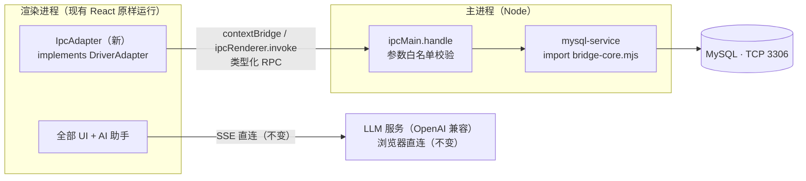

# 桌面客户端方案（Mac / Windows / Linux）

> 状态：方案评审稿 · 目标：将 MySQL Web Studio 以 PC 客户端形态分发，界面与 Web 端保持一致 · 候选技术：Electron（推荐）/ Tauri

## 1. 背景与目标

Web 形态的 MySQL 客户端存在固有局限：数据库访问必须经由桥接器中转（dev server 内嵌 WS 桥，或独立桥接服务 `npm run bridge`），部署、连接、分发都比原生应用多一道工序。将项目做成独立桌面客户端后：

- **数据通路更短**：主进程（Node）直接持有 mysql2 连接，进程内 IPC 通信，不再需要任何桥接器；
- **分发更简单**：一个安装包（dmg / exe / AppImage），双击即用，无需 Node 环境；
- **三形态长期共存**：Web、Chrome 插件、桌面客户端共用同一代码库与同一套 UI。

## 2. 现状盘点：改造的有利条件

桌面化能否"小步走"，取决于现有代码的抽象质量。本项目具备三个关键先决条件：

| 资产 | 位置 | 对桌面化的意义 |
| --- | --- | --- |
| `DriverAdapter` 接口 | `src/core/types.ts` | 数据访问已完全抽象为 10 个方法（connect / ping / close / listSchemas / listTables / getColumns / getSchemaColumns / getPK / showCreateTable / execute），渲染层不感知实现 |
| 桥接器核心模块 | `bridge/bridge-core.mjs` | mysql2 访问逻辑已从宿主中抽出（含连接池、参数校验、错误封装），现被 Vite 插件（`plugins/vite-plugin-mysql-bridge.mjs`）与独立桥接器（`scripts/bridge-server.mjs`）双宿主复用 |
| 渲染层无宿主耦合 | `src/` 全部 UI 与 `src/ai/` | 除 localStorage / WebSocket / fetch 外无宿主 API 依赖，可原样运行于任何 Chromium 容器 |

**结论：Electron 主进程即 Node 环境，`bridge-core.mjs` 可以直接 import 复用；渲染层 100% 原样。改造集中在新写 1 个 Adapter + 1 个 Electron 壳 + 1 层 IPC 封装。**

## 3. 技术选型：Electron（推荐）

| 维度 | Electron（推荐） | Tauri |
| --- | --- | --- |
| MySQL 访问 | 主进程即 Node，**mysql2 + bridge-core.mjs 原样复用，零重写** | Rust 侧需用 mysql_async 重写全部 10 个方法的桥（或挂 Node sidecar） |
| 现有代码复用 | 渲染层 100% 原样，新增 1 个 Adapter | 渲染层同原样，但后端全部重做 |
| 三平台打包 | electron-builder 成熟 | 打包成熟 |
| 产物体积 | ~85MB | ~10MB |
| 与目标契合度 | 界面一致、最小改动，完全命中 | 体积优势明显，但改造成本高 |

选型理由：核心诉求是"界面与 Web 端一致、尽量复用"。Tauri 的 10MB 体积优势需要拿"重写一整套 Rust 桥"去交换，不值；Electron 的体积与内存代价在 MySQL 客户端场景（用户本机常驻、非海量分发）可接受。

## 4. 目标架构

三种形态并存，Adapter 工厂按运行环境分发：

| 形态 | 数据通道 | 持久化 | 适用场景 |
| --- | --- | --- | --- |
| Web（现有） | WsAdapter → 同源 WS 桥 | localStorage | 团队内网 / 临时使用 |
| Chrome 插件（现有） | WsAdapter → 独立桥 `:5189` | chrome.storage | 浏览器常驻 |
| **桌面（新增）** | **IpcAdapter → 进程内 IPC → bridge-core** | localStorage（renderer 原生支持） | **日常主力工具** |

## 5. 代码改造清单

### 5.1 新增文件

| 文件 | 职责 |
| --- | --- |
| `src/adapters/ipc/index.ts` | `IpcAdapter implements DriverAdapter`：10 个方法逐个映射为 `window.desktopBridge.invoke('mysql:listSchemas', {...})` 风格的 RPC 调用 |
| `electron/preload.ts` | `contextBridge.exposeInMainWorld('desktopBridge', { invoke })`，仅暴露 `invoke` 一个入口，渲染层拿不到任何 Node 能力 |
| `electron/main.ts` | BrowserWindow 创建（`contextIsolation: true`、`sandbox: true`、无 nodeIntegration）；开发模式加载 `localhost:5188`（保留 HMR），生产模式走自定义协议 `app://` 加载静态资源 |
| `electron/mysql-service.ts` | 直接 import `bridge/bridge-core.mjs` 核心（连接池 + connect/query/元数据查询），按连接 id 维护实例；IPC handler 做参数白名单校验（host / port / user / password / database / sql 字符串），与现桥接器同源逻辑 |

### 5.2 修改点（各一两行）

| 位置 | 修改 |
| --- | --- |
| Adapter 工厂 | 探测 `window.desktopBridge` 存在 → `IpcAdapter`；否则维持现有 WsAdapter / DemoAdapter 分发 |
| `ConnectionType` | 增加 `desktop` 类型 |
| 连接配置表单 | 桌面模式下隐藏「桥接地址」高级选项（进程内通信，无桥可填） |

### 5.3 零改动

全部 UI 组件、AI 助手（风险守卫 / Agent 循环 / 五工具 / 上下文注入 / 会话管理）、确认矩阵、localStorage 持久化、`@表名` 补全、斜杠指令、SQL 代码块工具条。

## 6. 风险与对策

| 风险 | 说明 | 对策 |
| --- | --- | --- |
| AI SSE 跨域 | 生产模式页面源为 `app://`，部分模型 API 的 CORS / Origin 校验可能拒绝 | `session.webRequest.onHeadersReceived` 为模型域名白名单补 `Access-Control-Allow-Origin`；个别端点仍拒绝时退到主进程转发 SSE |
| 未签名分发 | mac Gatekeeper 拦截、Windows SmartScreen 提示 | 开发期 ad-hoc 签名 +「右键打开」引导；正式分发再做 Developer ID 签名 + 公证（需 Apple 开发者账号） |
| win / linux 无法本地验证 | 开发机为 macOS | GitHub Actions matrix（mac / win / ubuntu 三 job）出包并上传产物，用 CI 当测试台 |
| localStorage 稳定性 | `app://` 源下 localStorage 可用，但受「清除浏览数据」类操作影响 | P1 先沿用（零改动）；必要时后置切换为 userData 目录 JSON 文件 |

## 7. 实施分期

### P1 桌面骨架跑通（核心）

- `electron/main.ts` + `electron/preload.ts` + `electron/mysql-service.ts`（复用 bridge-core）
- `src/adapters/ipc/` + Adapter 工厂环境分发
- `npm run dev:desktop` 起完整功能（含 AI 助手）
- 冒烟清单：连接管理、建连/断开、SQL 执行、元数据树、AI 全链路（对话 / 工具 / 确认弹窗 / 斜杠指令）

### P2 打包分发

- electron-builder 配置：mac dmg + zip（arm64 / x64）、win nsis（x64）、linux AppImage + deb
- 应用图标（mac icns / win ico / linux png）
- GitHub Actions 三平台出包工作流

### P3 桌面体验打磨

- 原生菜单（SQL 文件导入 / 导出走系统对话框）
- 窗口状态记忆（尺寸 / 位置）
- 外链走 `shell.openExternal`（不内嵌浏览）
- AI CORS 域名白名单、错误日志落 userData

### P4（可选）

- Apple 公证 + Windows 签名证书
- electron-updater 自动更新
- userData JSON 持久化替代 localStorage

## 8. 额外利好

- **mysql2 为纯 JS 包**，无原生模块依赖，electron-builder 无需 electron-rebuild，三平台交叉打包干净；
- `bridge-core.mjs` 已带参数校验与错误封装，主进程侧安全面基本是"搬"而非"写"；
- DemoAdapter 为纯内存实现，桌面端开箱即用，无任何配置即可试用；
- AI 助手、风险分级等安全设计在桌面端原样生效（守卫仍在渲染层、确认矩阵不变）。

## 9. 安全边界（与 Web 形态一致的丑话在前）

- 桌面端主进程持有数据库连接，IPC handler 必须维持参数白名单，不提供任意进程 / 文件 / shell 能力；
- 渲染层继续 `contextIsolation` + `sandbox`，preload 仅暴露 `invoke`；
- AI 助手的模型 API Key 仍明文存于本机渲染层存储，与 Web 形态一致，请使用 HTTPS 端点；
- 风险守卫（`src/ai/agent/guard.ts`）是 AI 交互层安全网，桌面端数据库访问仍受其约束，但**不能替代**数据库自身的账号权限控制。

---

*相关文档：[架构说明](architecture.md) · [使用手册](usage.md) · [AI 助手规划](ai/README.md)*
